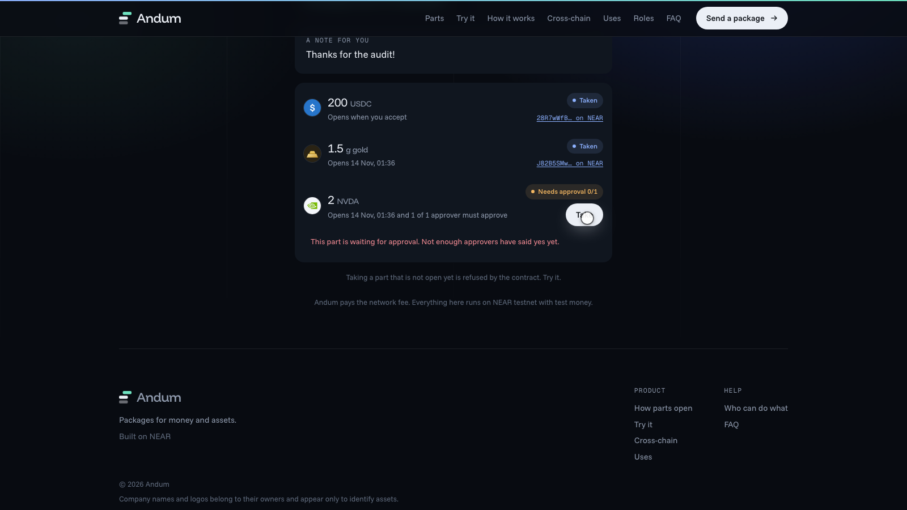
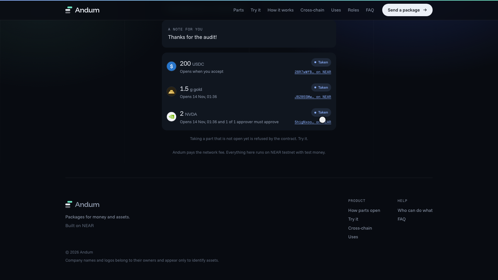

# Andum

**Send money and assets in one package.** Each part of a package opens on its own rule: right away, on a date, or on a date plus the approval of 1 to 5 people. The recipient holds the package as a non-transferable NFT pass, can see the funds before accepting, and nobody pays gas.


> **Status (13 Nov 2026):** the NEAR contracts and the EVM contracts are **deployed on testnet**, and the **web app is wired to the API**: a sender, a recipient and an approver, each in their own browser, run the whole flow on NEAR testnet through the real API, queue and worker. Everything is valueless test money. See [STATUS.md](STATUS.md) for what is done and what is not, and [ANDUM-PLAN.md](ANDUM-PLAN.md) for the design.

## Watch it work

**The product, in the browser** (three people, three browsers, NEAR testnet; full video: [`docs/media/app-demo.mp4`](docs/media/app-demo.mp4)). It is the recording of the automated browser test described under Tests, not a mock-up:


**The backend, queue and bridge from a terminal.** Real API, relayer, worker, Postgres, Redis and email (Mailpit) against **NEAR testnet**, then the bridge against **Sepolia** (sped up; full video: [`docs/report/demo-live-testnet.mp4`](docs/report/demo-live-testnet.mp4)):


## How it works

1. **Sender** signs in with an email code, builds a package (up to 8 parts, each with its own rule), and funds it. All actions are signed in the browser and relayed, so the sender pays no gas.
2. **Recipient** opens a link, sees the funds before accepting, proves their email, and receives the invite secret. Accepting mints the pass.
3. **Each part** opens by its rule. A part with approvers waits until enough of them approve (for example 2 of 3). A claim is final and cannot be taken twice.
4. **Expired and unaccepted** packages can be reclaimed by the sender.

Sign-in is non-custodial: an email code proves the address, and the browser generates and keeps the NEAR key (encrypted backup is optional). The server never holds a user key.


### The app

Run it yourself in five minutes: [Try it locally](#try-the-app-locally).

| Sender: wallet and builder | Sender: sent, link ready |
|---|---|
|  |  |

| Recipient: sees the funds before accepting | Recipient: the contract refuses part 2 until the approver says yes |
|---|---|
|  |  |

| Approver | Everything taken |
|---|---|
|  |  |

What the web app (`andum-web/`, Vite + React) does, all against the real API:

- **Sender** (`/app`): email code sign-in, test-token faucet, balances, a builder for up to 8 parts (each opens now, on a date, or on a date plus 1 to 5 approvers), then create, fund, email the invite and set a custom link. A failed step can be retried without sending twice. Sent packages can be reclaimed after the deadline.
- **Recipient** (`/p/<name>` or `/i/<id>`): sees the funds before accepting, signs in, proves the invite with a second code, accepts (the pass is minted), takes each part. Not-yet-open parts are refused by the contract and the reason is shown.
- **Approver** (`/app`, "To approve"): approves the parts they were named on.
- **Keys**: the browser creates the NEAR key and signs every action as a gasless delegate action. The server only sees the public key and signatures.

## Deployed contracts

### NEAR testnet (root account `hafidbuild.testnet`)

| Role | Account | What it does |
|---|---|---|
| core | [`core.hafidbuild.testnet`](https://testnet.nearblocks.io/address/core.hafidbuild.testnet) | Packages, parts, approvers, claim/reclaim, non-transferable NFT pass (NEP-171/177/181) |
| bridge | [`bridge.hafidbuild.testnet`](https://testnet.nearblocks.io/address/bridge.hafidbuild.testnet) | Demo bridge: burns outbound tokens, mints inbound on the relayer's word |
| relayer | [`relayer.hafidbuild.testnet`](https://testnet.nearblocks.io/address/relayer.hafidbuild.testnet) | Pays gas for users' delegate actions (NEP-366) and tops up new accounts |
| bridgeworker | [`bridgeworker.hafidbuild.testnet`](https://testnet.nearblocks.io/address/bridgeworker.hafidbuild.testnet) | Account the bridge worker signs `bridge_in` with |
| admin | [`admin.hafidbuild.testnet`](https://testnet.nearblocks.io/address/admin.hafidbuild.testnet) | Contract owner (pause, config). Holds no user funds |

Mock tokens (6 decimals, open capped faucet; USDC, IDRX and MYR are bridgeable):

| Token | Account |
|---|---|
| USDC | [`usdc.hafidbuild.testnet`](https://testnet.nearblocks.io/address/usdc.hafidbuild.testnet) |
| IDRX | [`idrx.hafidbuild.testnet`](https://testnet.nearblocks.io/address/idrx.hafidbuild.testnet) |
| MYR | [`myr.hafidbuild.testnet`](https://testnet.nearblocks.io/address/myr.hafidbuild.testnet) |
| XAU | [`xau.hafidbuild.testnet`](https://testnet.nearblocks.io/address/xau.hafidbuild.testnet) |
| AAPL | [`aapl.hafidbuild.testnet`](https://testnet.nearblocks.io/address/aapl.hafidbuild.testnet) |

Addresses are kept in [`deployments/near.testnet.json`](deployments/near.testnet.json). Contract methods and error codes are in `smart-contract-near/core/src` and `openspec/`.

### Sepolia

| Contract | Address |
|---|---|
| ERC-2771 forwarder | [`0x7FD46Af63cBC3B1f86123a2aa55e8b266279A19f`](https://sepolia.etherscan.io/address/0x7FD46Af63cBC3B1f86123a2aa55e8b266279A19f) |
| Gateway (demo bridge) | [`0x7168b9e971bBF030a386D6B7795f739Fb6d305FF`](https://sepolia.etherscan.io/address/0x7168b9e971bBF030a386D6B7795f739Fb6d305FF) |
| Relayer (bridge worker) | [`0x4469787CB7490704f86d462a626fe5B4252B884D`](https://sepolia.etherscan.io/address/0x4469787CB7490704f86d462a626fe5B4252B884D) |

| Token | Address |
|---|---|
| USDC | [`0xCbbDE212B6ea989be8010a4836c111aa0F6Dc169`](https://sepolia.etherscan.io/address/0xCbbDE212B6ea989be8010a4836c111aa0F6Dc169) |
| IDRX | [`0xd192192f558130Fec49afFDA1981f06D477f76Ac`](https://sepolia.etherscan.io/address/0xd192192f558130Fec49afFDA1981f06D477f76Ac) |
| MYR | [`0xB9C8eFfD6EF3877A936d4abf388c07A3C1cb8352`](https://sepolia.etherscan.io/address/0xB9C8eFfD6EF3877A936d4abf388c07A3C1cb8352) |
| SGD | [`0xD6189ceBC4dC2d55FfE8BcB0321014d98dFD5c28`](https://sepolia.etherscan.io/address/0xD6189ceBC4dC2d55FfE8BcB0321014d98dFD5c28) |
| THB | [`0xB214a70931a64E32dcac0D875b4a33D0e5DA14d7`](https://sepolia.etherscan.io/address/0xB214a70931a64E32dcac0D875b4a33D0e5DA14d7) |
| EUR | [`0xdf4e5454C43d4c8bD63c45aECb38713a4778546a`](https://sepolia.etherscan.io/address/0xdf4e5454C43d4c8bD63c45aECb38713a4778546a) |
| JPY | [`0x55BC63b90268514AC8c5e02c95410715b16e85Ff`](https://sepolia.etherscan.io/address/0x55BC63b90268514AC8c5e02c95410715b16e85Ff) |
| XAU | [`0xf64436776B4d9a182E69aD317a1698966d2753f4`](https://sepolia.etherscan.io/address/0xf64436776B4d9a182E69aD317a1698966d2753f4) |
| AAPL | [`0x7AC30647cC1cE87841964dF25058Ef0C2459Da55`](https://sepolia.etherscan.io/address/0x7AC30647cC1cE87841964dF25058Ef0C2459Da55) |
| NVDA | [`0x627d7f538a20eAdd707EBB30Cc458BBDf8Ab4347`](https://sepolia.etherscan.io/address/0x627d7f538a20eAdd707EBB30Cc458BBDf8Ab4347) |
| TSLA | [`0x431E5682565ac30cd0C98155f813B0b2589d7C19`](https://sepolia.etherscan.io/address/0x431E5682565ac30cd0C98155f813B0b2589d7C19) |

Addresses are kept in [`deployments/sepolia.json`](deployments/sepolia.json). Base Sepolia is not deployed yet.

## What is in the repo

| Folder | What |
|---|---|
| `smart-contract-near/` | Rust (near-sdk 5): `core`, `mock-ft` (faucet token), `bridge`, `integration` (sandbox tests on the real wasm) |
| `smart-contract-evm/` | Foundry: `MockERC20`, `AndumGateway` (burn/mint demo bridge, ERC-2771 gasless) |
| `backend/` | NestJS API: email login, sessions, invites + OTP, custom links, relay submit (policy checked), package reads, faucet, bridge quotes, SSE |
| `worker/` | NestJS worker: relayer (BullMQ), reconciler/indexer, notifier, bridge worker |
| `shared/` | NEP-366 codec, relayer policy engine, chain client, DB migrations, mailer |
| `andum-web/` | The web app: landing page, sender app, receiver and approver views (Vite + React), with unit tests and Playwright browser tests |
| `scripts/` | `deploy-near.sh`, `deploy-evm.sh`, `keys.mjs`, `live/` (live checks), `demo/` (narrated demo), `report/` (video tools) |
| `openspec/` | Specs and tasks per change (`openspec list`, `openspec validate --all`) |
| `docs/` | [`LIVE-RUNBOOK.md`](docs/LIVE-RUNBOOK.md), [`interface-changes.md`](docs/interface-changes.md), [`report/`](docs/report/) (PDF report, videos, logs) |

## Tests

All of these pass: 288 TypeScript backend-side tests (shared 79, backend 146, worker 63), 131 Rust (124 unit, 7 on the compiled wasm in the NEAR sandbox), 38 Solidity, **238 web unit and integration tests and 10 browser end-to-end tests**. They cover positive, negative and edge cases.


```bash
# NEAR contracts (Rust). First time: rustup default stable && rustup target add wasm32-unknown-unknown
cd smart-contract-near
cargo test --workspace --exclude andum-integration         # 124 unit tests
cargo build --release --target wasm32-unknown-unknown      # .cargo/config.toml adds --cfg near (required)
cargo test -p andum-integration -- --test-threads=1        # sandbox tests, downloads the NEAR sandbox once

# EVM
cd smart-contract-evm && forge test                         # 38 tests

# TypeScript backend (needs Postgres and Redis)
createdb andum_test    # defaults: postgres://andum@localhost:5544/andum_test and redis://localhost:6390
npm install && npm run build -w shared
npm test                                                    # shared + backend + worker

# Web app
cd andum-web && npm install && npm test                    # 238 tests, no network needed
```

Override the test services with `TEST_DATABASE_URL` and `TEST_REDIS_URL`.

**What the web tests cover**

| Layer | Where | What |
|---|---|---|
| Form rules | `src/lib/draft.test.ts`, `money.test.ts` | Every bad input (email, amounts with 7 decimals or zero, dates in the past, 9 parts, approvers without a date, duplicate or too many approvers, threshold out of range, reserved link names) and the good ones, including amounts above 2^53 and time zones |
| API client | `src/lib/api.test.ts` | Server error codes, non-JSON errors, empty bodies, network failure, timeout, plain-language text for every contract and API error |
| Receiver pages | `src/pages/ReceivePage.test.tsx` | Link and invite routes, old-name redirect, unknown, malformed and rate-limited links, API down, expired, accepted and reclaimed packages; the sign-in, invite code and accept flow with wrong, expired and locked codes, resend cooldown, contract and relayer refusals, returning users |
| Sender flow | `src/components/app/Send.test.tsx` | The signed calls are decoded and run through the relayer's own policy engine (`shared/src/policy.ts`), so a call the relayer would refuse fails the test; retry reuses the invite; a taken link name returns to the form |
| Browser, API only | `e2e/guards.spec.ts` (9 tests) | A real browser against the real API: malformed, unknown and unreachable links; invalid email, wrong and short code, reload and sign-out, a second device without the key, the resend cooldown; the builder refuses every bad input and sends nothing |
| Browser, full journey | `e2e/journey.spec.ts` | Three browsers on **NEAR testnet**: faucet, build, fund, email, preview, wrong invite code, accept, take part 1, part 2 refused too early, refused without approval, approver approves, part 2 taken, USDC balance checked, link locked for a stranger |

```bash
# with the stack running (see below) and the web app on :3000
cd andum-web && npx playwright install chromium            # first time
npm run test:e2e:guards                                     # about 1.5 minutes, no chain
npm run test:e2e                                            # adds the testnet journey, about 5 minutes
```

## Try the app locally

Needs Docker (for Mailpit, the local inbox), Postgres, Redis and the testnet keys. Full steps in [`docs/LIVE-RUNBOOK.md`](docs/LIVE-RUNBOOK.md).

```bash
docker compose up -d mailpit                 # inbox UI http://localhost:8025 (sign-in codes arrive here)
npm install && npm run build
set -a; . deployments/secrets/live.env; set +a   # generate with: node scripts/keys.mjs gen
node backend/dist/main.js &  node worker/dist/main.js &
cd andum-web && cp .env.example .env.local && npm install && npm run dev    # http://localhost:3000
```

Open http://localhost:3000/app and sign in with any email (read the code in Mailpit). Open the recipient's link in a **different browser profile or a private window**: each browser keeps its own key, one per email, so that is how one person plays the sender, the recipient and the approver. To approve, the approver signs in first and gives the sender the account shown at the top of the page.

## Run it against the deployed testnet contracts

Full steps in [`docs/LIVE-RUNBOOK.md`](docs/LIVE-RUNBOOK.md). In short:

```bash
docker compose up -d mailpit                 # SMTP :1025, inbox UI http://localhost:8025
# start Postgres and Redis (docker compose up -d postgres redis, or local installs)
npm install && npm run build
set -a; . deployments/secrets/live.env; set +a   # relayer key etc. (gitignored; generate with: node scripts/keys.mjs gen)
node backend/dist/main.js &  node worker/dist/main.js &
node scripts/live/live-e2e.mjs               # full journey on NEAR testnet, 16 checks
node scripts/live/live-bridge.mjs            # bridge rehearsal (NET=sepolia for the real Sepolia)
```

To deploy your own copy: `./scripts/deploy-near.sh` (needs a funded testnet account key in `./secret`) and `./scripts/deploy-evm.sh sepolia`. Both are resumable.

## Trust points and mocks (be honest in the demo)

- All tokens are valueless mocks with an open faucet.
- The "bridge" is a trusted relayer that burns on one chain and mints on the other. The production path is NEAR Intents.
- The contract admin can upgrade the contract. It has no method that moves user funds.
- The backend holds invite secrets (encrypted) and releases one only after an emailed code. The secret becomes public in the accept transaction (single use, short deadline).
- Privy login is built but its NEAR signing is unverified; email login is the default path. Web3Auth is not implemented.
- The web app keeps each NEAR key in the browser's `localStorage`, unencrypted, and has no recovery screen yet: clearing site data loses the account (the API supports an encrypted key backup, the UI does not use it). A second device cannot sign in to the same email.
- Sign-in codes are emailed through Mailpit locally. A real mail provider is not configured.
- The web app covers NEAR packages only. Bridge, notifications settings and the EVM side are API features without a screen yet.
- The browser tests need the live stack and testnet funds; the guard tests need only the API.
- The HTML prototypes and `andum-web/` are design material; all contract and backend code here is new.
