<div align="center">


# Andum

### Programmable gifts and payments. One package, a different rule for every part.

Send money, gold or tokenized stocks in a single package.<br>
Each part opens on its own terms. The sender pays no gas.

[**Live landing page**](https://andum.projectdeadwood.my.id/) &nbsp;·&nbsp; [**Demo video**](docs/media/app-demo.mp4) &nbsp;·&nbsp; [Product plan](ANDUM-PLAN.md) &nbsp;·&nbsp; [Status](STATUS.md)


<br>

<a href="https://andum.projectdeadwood.my.id/"></a>

</div>

<br>

## The idea

A normal transfer is all or nothing. Andum lets the sender decide **when** each slice of a gift, salary or reward becomes available, and lets the recipient **see the funds before accepting**.

| Opens when the recipient accepts | Opens on a date | Opens on a date, after an approver agrees |
|:---|:---|:---|
| A welcome amount, available at once | A bonus that unlocks on a birthday or deadline | A milestone payment released by an independent person |

- Up to 8 parts per package, in any mix of money, gold and stocks
- Approvers can be required in groups, for example 2 of 3
- Unaccepted or expired packages go back to the sender
- Every rule is enforced by the contract, not by the app

<br>

<div align="center">
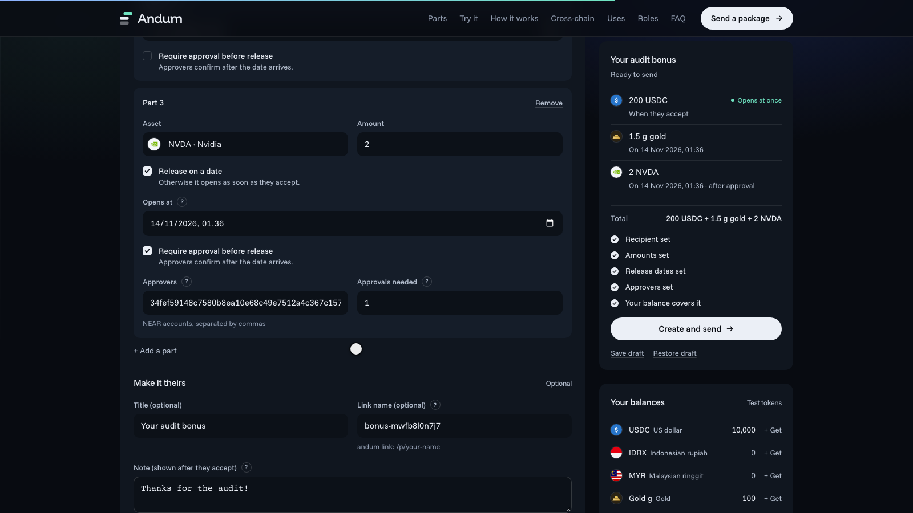
<br>
<sub>The package builder. Each part carries its own release rule.</sub>
</div>

<br>

> **Status: working prototype on NEAR testnet and Sepolia.** The full sender, recipient and approver journey runs end to end with separate browser accounts. All tokens are valueless test assets. Scope is in [STATUS.md](STATUS.md).

## The journey in 60 seconds

<div align="center">
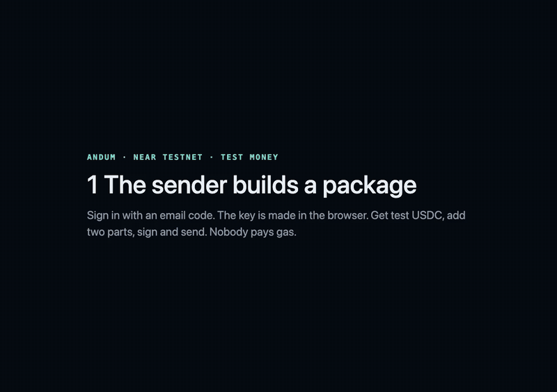
<br>
<sub>Recorded from a real run on NEAR testnet: a sender, a recipient and an approver in three browsers. <a href="docs/media/app-demo.mp4">Full video (1:26)</a></sub>
</div>

<br>

<table>
<tr>
<td width="33%" valign="top">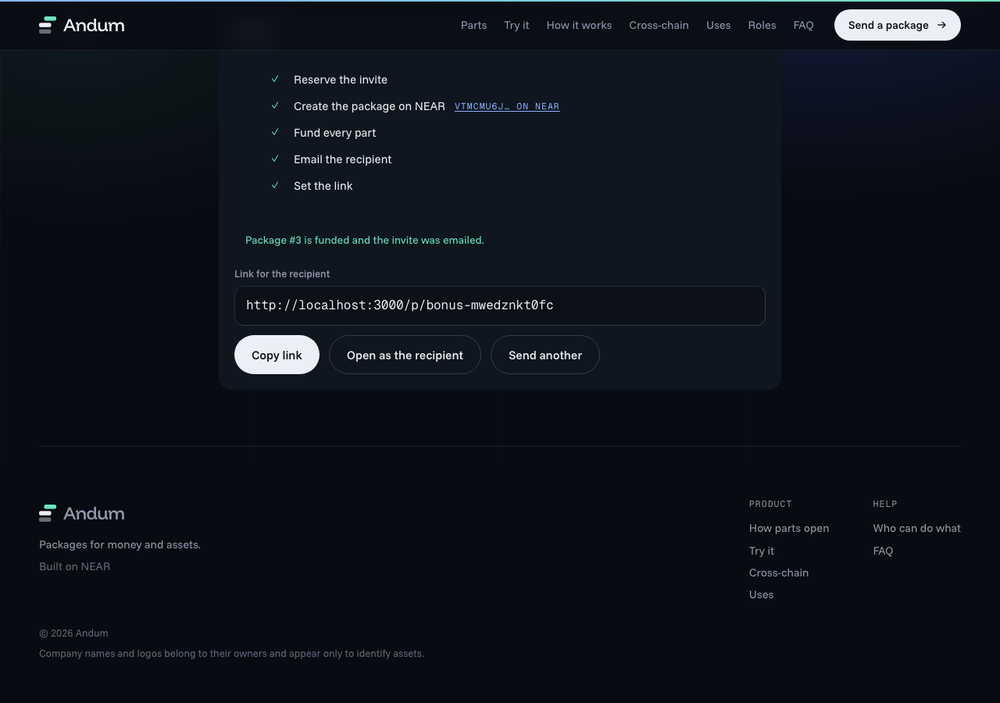<br><b>1 · Send</b><br>The sender builds and funds the package. Every part is locked in the contract.</td>
<td width="33%" valign="top">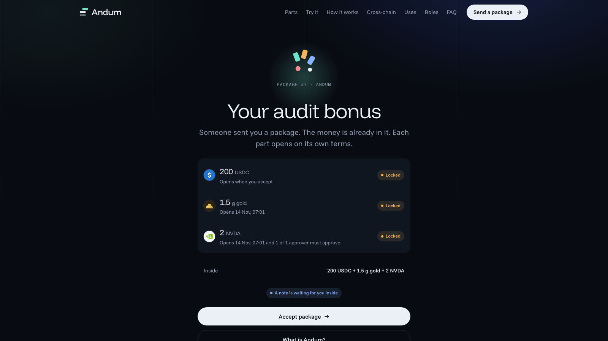<br><b>2 · Preview</b><br>The recipient opens a link and sees what is inside before accepting.</td>
<td width="33%" valign="top">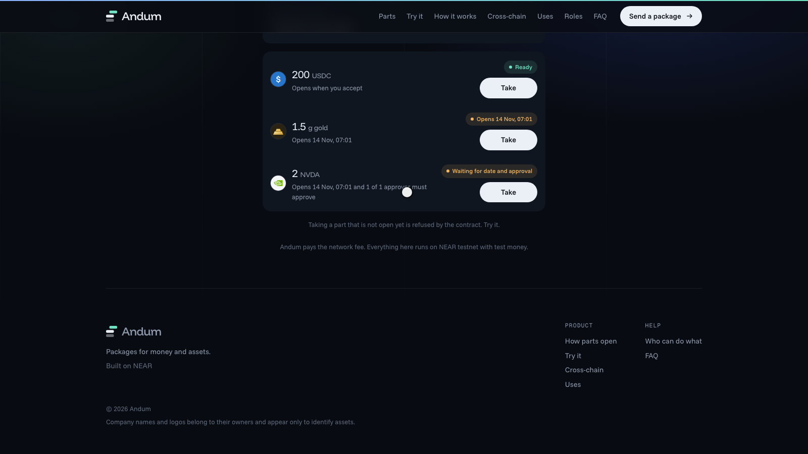<br><b>3 · Accept</b><br>An emailed code proves identity. Accepting mints a non-transferable pass.</td>
</tr>
<tr>
<td valign="top">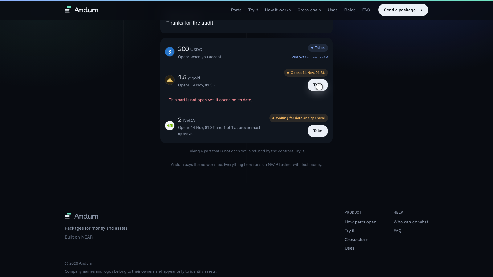<br><b>4 · Enforce</b><br>A locked part is refused by the contract: too early, then not approved.</td>
<td valign="top">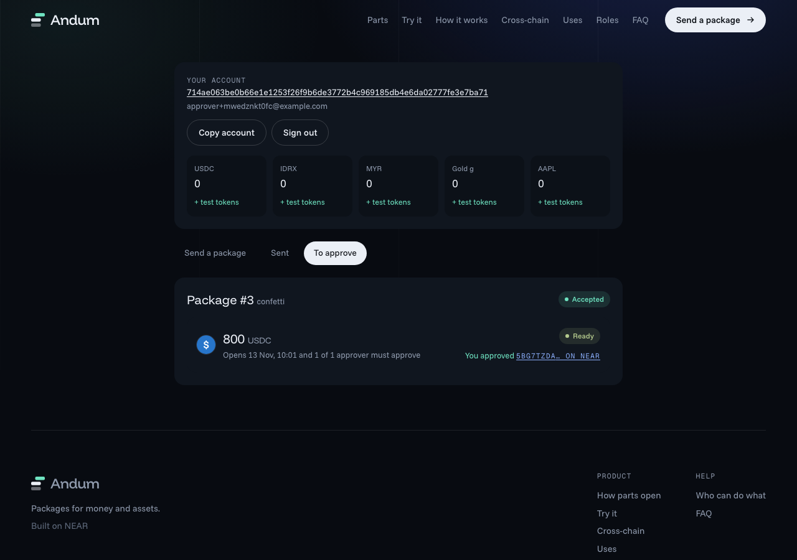<br><b>5 · Approve</b><br>A different person with a different key releases the final part.</td>
<td valign="top">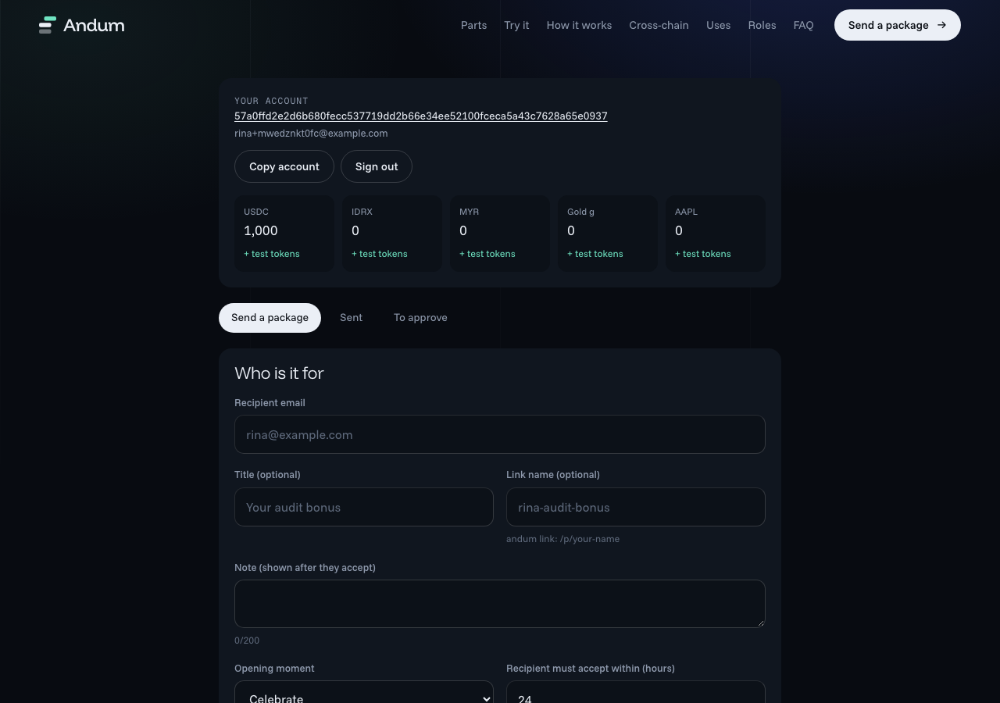<br><b>6 · Receive</b><br>The money lands in the recipient's account. A claim can never be taken twice.</td>
</tr>
</table>

<details>
<summary>More screens: guide, hints, withdraw, guard rails, wallet, wrong code, mobile</summary>
<br>

| First-run guide | A hint on a field | Withdraw to any NEAR address |
|:---:|:---:|:---:|
| 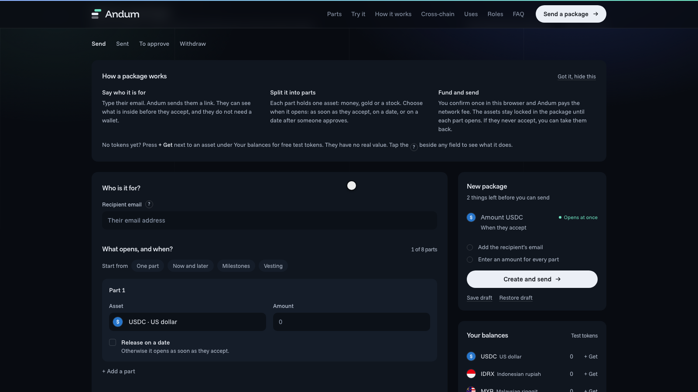 | 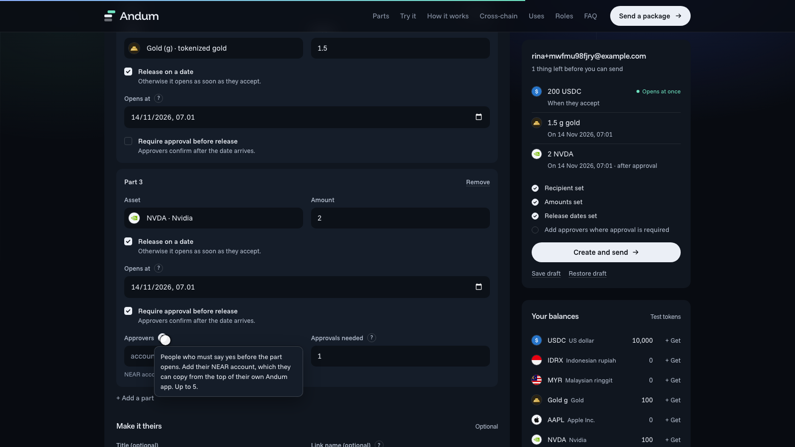 | 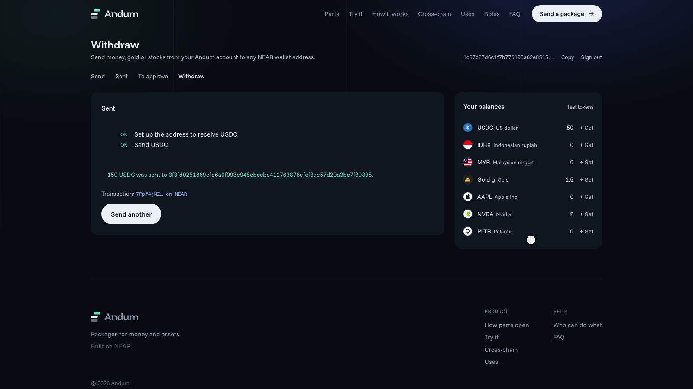 |

| Guard rails | Wallet and faucet | Wrong code refused | Mobile receiver |
|:---:|:---:|:---:|:---:|
| 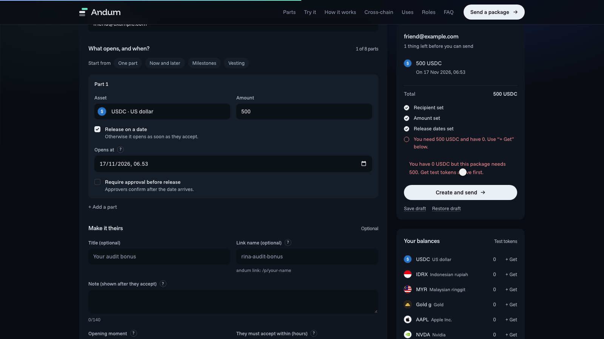 | 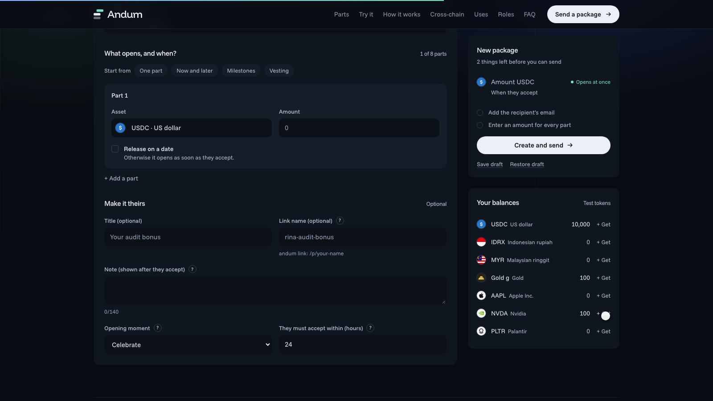 | 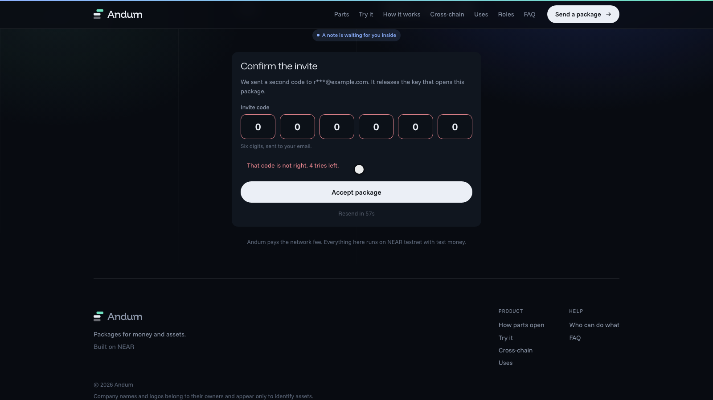 | 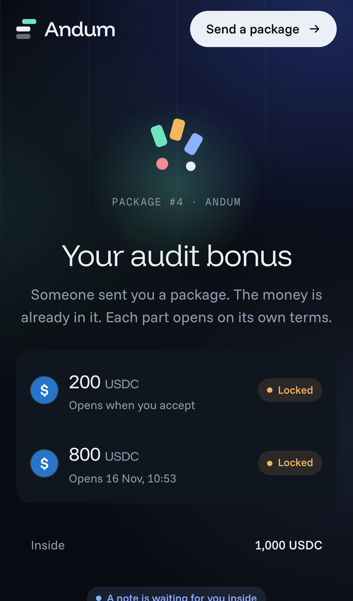 |

</details>

## How it works

1. **Sender** signs in with an email code, builds a package (up to 8 parts, each with its own rule), and funds it. All actions are signed in the browser and relayed, so the sender pays no gas.
2. **Recipient** opens a link, sees the funds before accepting, proves their email, and receives the invite secret. Accepting mints the pass.
3. **Each part** opens by its rule. A part with approvers waits until enough of them approve (for example 2 of 3). A claim is final and cannot be taken twice.
4. **Expired and unaccepted** packages can be reclaimed by the sender.

Sign-in is non-custodial: an email code proves the address, and the browser generates and keeps the NEAR key. The server never holds a user key.

What the web app (`andum-web/`, Vite + React) does, all against the real API:

- **Sender** (`/app`): sign-in, a first-run guide and a `?` hint on every confusing field, test-token faucet, balances, the builder (starting points that set the release rules, never the money; a live summary of what is being sent and what is still missing), create, fund, email and custom link. A failed step can be retried without sending twice. Sent packages can be reclaimed after the deadline.
- **Withdraw** (`/app`, "Withdraw"): send any asset to any NEAR address. The address is checked first (not your own account, not an Andum contract, not an Ethereum address), a new address is registered with the token, then the transfer is sent. The relayer pays the gas.
- **Recipient** (`/p/<name>` or `/i/<id>`): preview, sign-in, invite code, accept, take each part. Refusals show the reason in plain words.
- **Approver** (`/app`, "To approve"): approves the parts they were named on.

## Try it yourself

You need Docker (for the local inbox), Postgres, Redis and the testnet keys. The recipient and the approver must use **different browser profiles or private windows**: each browser keeps its own key, one per email.

<details>
<summary>Start the app (commands)</summary>

```bash
docker compose up -d mailpit                 # inbox UI http://localhost:8025, sign-in codes arrive here
npm install && npm run build
set -a; . deployments/secrets/live.env; set +a   # generate with: node scripts/keys.mjs gen
node backend/dist/main.js &  node worker/dist/main.js &
cd andum-web && cp .env.example .env.local && npm install && npm run dev
```

Then open http://localhost:3000/app and sign in with any email. To name an approver, they sign in first and give the sender the account shown at the top of their page. Full steps: [`docs/LIVE-RUNBOOK.md`](docs/LIVE-RUNBOOK.md).
</details>

## Tests

**Every number below is a passing test.** They cover positive, negative and edge cases.

| Area | Tests | What it proves |
|---|---|---|
| Web app, unit and integration | 277 | Form rules, API client, receiver, sender and withdraw flows, hints and guide, and that every call the browser signs passes the relayer's own policy |
| Browser end to end | 10 | A real browser on the real API (9 guards), and the full three-person journey on NEAR testnet |
| Backend API, worker, shared | 303 | Login, invites, relay policy (including withdrawals), queue, reconciler, notifier, bridge worker (shared 94, backend 146, worker 63) |
| NEAR contracts | 131 | 124 unit tests, 7 on the compiled wasm in the NEAR sandbox |
| EVM contracts | 38 | Mock tokens, gateway, gasless forwarder |

The browser tests are the same ones that produced the screenshots above. What each web layer covers:

| Layer | Where | What |
|---|---|---|
| Form rules | `src/lib/draft.test.ts`, `money.test.ts` | Bad emails, zero amounts or 7 decimals, dates in the past, 9 parts, approvers without a date, duplicates, threshold out of range, reserved link names; amounts above 2^53; time zones |
| API client | `src/lib/api.test.ts` | Server error codes, non-JSON errors, network failure, timeout, plain-language text for every contract and API error |
| Receiver pages | `src/pages/ReceivePage.test.tsx` | Unknown, malformed and rate-limited links, API down, expired, accepted and reclaimed packages; wrong, expired and locked codes, resend cooldown, contract and relayer refusals, returning users |
| Sender flow | `src/components/app/Send.test.tsx`, `Workspace.test.tsx` | Signed calls are decoded and checked by the relayer's policy engine; retry reuses the invite; a taken link name returns to the form; starting points never set amounts; the summary lists what is missing |
| Withdraw, hints, guide | `src/components/app/Withdraw.test.tsx` | Every refused address and amount, a new address registered then sent, the signed calls passing the policy, the guide shown once, `?` hints |
| Browser, API only | `e2e/guards.spec.ts` | Links, sign-in errors, reload and sign-out, a second device without the key, the builder refusing every bad input |
| Browser, full journey | `e2e/journey.spec.ts` | Faucet, build, fund, email, preview, wrong code, accept, take part 1, part 2 refused twice, approval, part 2 taken, balance checked, link locked for a stranger |

<details>
<summary>Run the tests (commands)</summary>

```bash
# Web app (no network needed)
cd andum-web && npm install && npm test                          # 277 tests

# Browser tests, with the stack and the web app running on :3000
cd andum-web && npx playwright install chromium                 # first time
npm run test:e2e:guards                                          # about 1.5 minutes, no chain
npm run test:e2e                                                 # adds the testnet journey, about 5 minutes

# Backend (needs Postgres and Redis; override with TEST_DATABASE_URL and TEST_REDIS_URL)
createdb andum_test                                              # postgres://andum@localhost:5544/andum_test, redis://localhost:6390
npm install && npm run build -w shared && npm test

# NEAR contracts. First time: rustup default stable && rustup target add wasm32-unknown-unknown
cd smart-contract-near
cargo test --workspace --exclude andum-integration               # 124 unit tests
cargo build --release --target wasm32-unknown-unknown            # .cargo/config.toml adds --cfg near (required)
cargo test -p andum-integration -- --test-threads=1              # sandbox tests

# EVM
cd smart-contract-evm && forge test                              # 38 tests
```
</details>

## Deployed contracts

### NEAR testnet (root account `hafidbuild.testnet`)

| Role | Account | What it does |
|---|---|---|
| core | [`core.hafidbuild.testnet`](https://testnet.nearblocks.io/address/core.hafidbuild.testnet) | Packages, parts, approvers, claim/reclaim, non-transferable NFT pass (NEP-171/177/181) |
| bridge | [`bridge.hafidbuild.testnet`](https://testnet.nearblocks.io/address/bridge.hafidbuild.testnet) | Demo bridge: burns outbound tokens, mints inbound on the relayer's word |
| relayer | [`relayer.hafidbuild.testnet`](https://testnet.nearblocks.io/address/relayer.hafidbuild.testnet) | Pays gas for users' delegate actions (NEP-366) and tops up new accounts |
| bridgeworker | [`bridgeworker.hafidbuild.testnet`](https://testnet.nearblocks.io/address/bridgeworker.hafidbuild.testnet) | Account the bridge worker signs `bridge_in` with |
| admin | [`admin.hafidbuild.testnet`](https://testnet.nearblocks.io/address/admin.hafidbuild.testnet) | Contract owner (pause, config). Holds no user funds |

Mock tokens: money (USDC, IDRX, MYR), gold (XAU) and tokenized stocks (AAPL, NVDA, PLTR). All have 6 decimals and an open, capped faucet; only USDC, IDRX and MYR are bridgeable. The web app shows each with its symbol and logo.

| Token | Account |
|---|---|
| USDC | [`usdc.hafidbuild.testnet`](https://testnet.nearblocks.io/address/usdc.hafidbuild.testnet) |
| IDRX | [`idrx.hafidbuild.testnet`](https://testnet.nearblocks.io/address/idrx.hafidbuild.testnet) |
| MYR | [`myr.hafidbuild.testnet`](https://testnet.nearblocks.io/address/myr.hafidbuild.testnet) |
| XAU | [`xau.hafidbuild.testnet`](https://testnet.nearblocks.io/address/xau.hafidbuild.testnet) |
| AAPL | [`aapl.hafidbuild.testnet`](https://testnet.nearblocks.io/address/aapl.hafidbuild.testnet) |
| NVDA | [`nvda.hafidbuild.testnet`](https://testnet.nearblocks.io/address/nvda.hafidbuild.testnet) |
| PLTR | [`pltr.hafidbuild.testnet`](https://testnet.nearblocks.io/address/pltr.hafidbuild.testnet) |

Addresses are kept in [`deployments/near.testnet.json`](deployments/near.testnet.json). Contract methods and error codes are in `smart-contract-near/core/src` and `openspec/`.

### Example: one package, on the chain

These are real transactions from a run on NEAR testnet (package `#1` on `core.hafidbuild.testnet`). Every one was signed by the user in the browser as a delegate action, and **the relayer paid the gas**: the user's own account is the `sender`, the relayer is only the transaction signer. A sender gives a recipient 1,000 USDC in two parts: 200 USDC **right away**, and 800 USDC **on a date, once an approver agrees**.

| # | Who | Contract call | What happens | Transaction |
|---|---|---|---|---|
| 1 | Sender | `core.create_package` | Writes the terms: two parts, the date, the approver, an invite hash and a note | [`G6UBR6…1Uqh`](https://testnet.nearblocks.io/txns/G6UBR6TuqbyZERVS432ZP43oiXzXfatArTdrcTy51Uqh) |
| 2 | Sender | `usdc.ft_transfer_call` | Moves 200 USDC into part 0 (message names the package and part) | [`4x8x1T…XwMx`](https://testnet.nearblocks.io/txns/4x8x1TH3GxwvWfww3w9o98zT95xUk5xR1KJfd8yLXwMx) |
| 3 | Sender | `usdc.ft_transfer_call` | Moves 800 USDC into part 1 | [`6f75fU…CLba`](https://testnet.nearblocks.io/txns/6f75fU1xfyw5X5N25yWNepeSCJqhbpqBegMYybBWCLba) |
| 4 | Recipient | `core.accept_package` | Proves they hold the invite secret and receives the non-transferable NFT pass | [`BKCf5G…LzVT`](https://testnet.nearblocks.io/txns/BKCf5GRkvJXxo2zBjZbSavQ8ZecGzLkoLqAyk6jKLzVT) |
| 5 | Recipient | `core.claim` (part 0) | Part 0 is open, so 200 USDC goes straight to the recipient | [`G5ZVsS…bx3N`](https://testnet.nearblocks.io/txns/G5ZVsSfULkncTNuSCbnvEo7X6KbVue4nJC7ytgjkbx3N) |
| 6 | Approver | `core.approve_part` (part 1) | The approver agrees, which unlocks the part once the date has passed | [`HTYry2…fYF1`](https://testnet.nearblocks.io/txns/HTYry2ey38m5ZcsSh357M3yi3UDoVFacPDeeAam9fYF1) |
| 7 | Recipient | `core.claim` (part 1) | Date passed and approved, so 800 USDC goes to the recipient | [`5p3PLR…Ms3h`](https://testnet.nearblocks.io/txns/5p3PLRNUfGkVZmRgNy14ZN5ACPN9uXfMsAd3PsCYMs3h) |

What the sender signs for step 1 (`create_package` arguments; amounts are in the token's smallest unit, 6 decimals, so `200000000` is 200 USDC):

```json
{ "args": {
    "parts": [
      { "token": "usdc.hafidbuild.testnet", "amount": "200000000" },
      { "token": "usdc.hafidbuild.testnet", "amount": "800000000",
        "unlock_ns": "1794490457794141696",
        "approvers": ["f04f458d4d4fb57dc432018f7b075015a097df5b99e6efb02f1d1651fd4d2491"] }
    ],
    "accept_by_ns": "1794493907794141696",
    "invite_hash": "+k9d9u2jyBFp0qTgsNdqErv3Nast8ekTYhtgGc5qj4M=",
    "theme": "confetti",
    "note": "Thanks for the audit!" } }
```

Step 2 and 3 fund each part. The call goes to the token and its `msg` tells the core contract which part the money is for: `{"receiver_id":"core.hafidbuild.testnet","amount":"200000000","msg":"{\"package_id\":\"1\",\"part_id\":0}"}` (deposit: 1 yoctoNEAR, as NEP-141 requires).

Anyone can read the result straight from the chain, with no account and no API:

```bash
near view core.hafidbuild.testnet get_package '{"package_id":"1"}' --networkId testnet
```

```json
{ "id": "1", "status": "ACCEPTED", "note": "Thanks for the audit!",
  "parts": [
    { "part_id": 0, "amount": "200000000", "funded": "200000000", "unlock_ns": null,
      "approvers": [], "state": "TAKEN" },
    { "part_id": 1, "amount": "800000000", "funded": "800000000", "unlock_ns": "1794490457794141696",
      "approvers": ["f04f458d…d2491"], "threshold": 1, "approved": true, "state": "TAKEN" } ] }
```

(Output shortened: the sender, owner and a few timestamp fields are left out.) The invite secret used in step 4 is not shown here: it is a one-time value that the receiver gets by email.

### Sepolia

| Contract | Address |
|---|---|
| ERC-2771 forwarder | [`0x7FD46Af63cBC3B1f86123a2aa55e8b266279A19f`](https://sepolia.etherscan.io/address/0x7FD46Af63cBC3B1f86123a2aa55e8b266279A19f) |
| Gateway (demo bridge) | [`0x7168b9e971bBF030a386D6B7795f739Fb6d305FF`](https://sepolia.etherscan.io/address/0x7168b9e971bBF030a386D6B7795f739Fb6d305FF) |
| Relayer (bridge worker) | [`0x4469787CB7490704f86d462a626fe5B4252B884D`](https://sepolia.etherscan.io/address/0x4469787CB7490704f86d462a626fe5B4252B884D) |

| Token | Address |
|---|---|
| USDC | [`0xCbbDE212B6ea989be8010a4836c111aa0F6Dc169`](https://sepolia.etherscan.io/address/0xCbbDE212B6ea989be8010a4836c111aa0F6Dc169) |
| IDRX | [`0xd192192f558130Fec49afFDA1981f06D477f76Ac`](https://sepolia.etherscan.io/address/0xd192192f558130Fec49afFDA1981f06D477f76Ac) |
| MYR | [`0xB9C8eFfD6EF3877A936d4abf388c07A3C1cb8352`](https://sepolia.etherscan.io/address/0xB9C8eFfD6EF3877A936d4abf388c07A3C1cb8352) |
| SGD | [`0xD6189ceBC4dC2d55FfE8BcB0321014d98dFD5c28`](https://sepolia.etherscan.io/address/0xD6189ceBC4dC2d55FfE8BcB0321014d98dFD5c28) |
| THB | [`0xB214a70931a64E32dcac0D875b4a33D0e5DA14d7`](https://sepolia.etherscan.io/address/0xB214a70931a64E32dcac0D875b4a33D0e5DA14d7) |
| EUR | [`0xdf4e5454C43d4c8bD63c45aECb38713a4778546a`](https://sepolia.etherscan.io/address/0xdf4e5454C43d4c8bD63c45aECb38713a4778546a) |
| JPY | [`0x55BC63b90268514AC8c5e02c95410715b16e85Ff`](https://sepolia.etherscan.io/address/0x55BC63b90268514AC8c5e02c95410715b16e85Ff) |
| XAU | [`0xf64436776B4d9a182E69aD317a1698966d2753f4`](https://sepolia.etherscan.io/address/0xf64436776B4d9a182E69aD317a1698966d2753f4) |
| AAPL | [`0x7AC30647cC1cE87841964dF25058Ef0C2459Da55`](https://sepolia.etherscan.io/address/0x7AC30647cC1cE87841964dF25058Ef0C2459Da55) |
| NVDA | [`0x627d7f538a20eAdd707EBB30Cc458BBDf8Ab4347`](https://sepolia.etherscan.io/address/0x627d7f538a20eAdd707EBB30Cc458BBDf8Ab4347) |
| TSLA | [`0x431E5682565ac30cd0C98155f813B0b2589d7C19`](https://sepolia.etherscan.io/address/0x431E5682565ac30cd0C98155f813B0b2589d7C19) |

Addresses are kept in [`deployments/sepolia.json`](deployments/sepolia.json). Base Sepolia is not deployed yet.

## Live deployment

| Part | Where |
|---|---|
| Web app and landing page | https://andum.projectdeadwood.my.id/ (the app is at `/app`) |
| API | https://andum-backend.projectdeadwood.my.id (`/readyz` reports database, queue and NEAR) |

The API and the worker run as two small containers behind nginx and Let's Encrypt, sharing an existing Postgres and Redis to save resources: `deploy/docker-compose.shared.yml`, `deploy/make-env.sh` and `deploy/deploy.sh` (`up`, `env`, `status`, `logs`, `rollback`). Secrets live in a gitignored `deploy/.env.production`.

## What is in the repo

| Folder | What |
|---|---|
| `smart-contract-near/` | Rust (near-sdk 5): `core`, `mock-ft` (faucet token), `bridge`, `integration` (sandbox tests on the real wasm) |
| `smart-contract-evm/` | Foundry: `MockERC20`, `AndumGateway` (burn/mint demo bridge, ERC-2771 gasless) |
| `backend/` | NestJS API: email login, sessions, invites + OTP, custom links, relay submit (policy checked), package reads, faucet, bridge quotes, SSE |
| `worker/` | NestJS worker: relayer (BullMQ), reconciler/indexer, notifier, bridge worker |
| `shared/` | NEP-366 codec, relayer policy engine, chain client, DB migrations, mailer |
| `andum-web/` | The web app: landing page, sender app, receiver and approver views (Vite + React), with unit tests and Playwright browser tests |
| `scripts/` | `deploy-near.sh`, `deploy-evm.sh`, `keys.mjs`, `live/` (live checks), `demo/` (narrated demo), `report/` (video tools) |
| `openspec/` | Specs and tasks per change (`openspec list`, `openspec validate --all`) |
| `docs/` | [`LIVE-RUNBOOK.md`](docs/LIVE-RUNBOOK.md), [`interface-changes.md`](docs/interface-changes.md), [`report/`](docs/report/) (PDF report, videos, logs) |

## Under the hood (terminal runs)

The same flows driven from scripts, without a browser: the real API, relayer, worker, Postgres, Redis and email against **NEAR testnet**, then the bridge against **Sepolia** (sped up; full video: [`docs/report/demo-live-testnet.mp4`](docs/report/demo-live-testnet.mp4)).

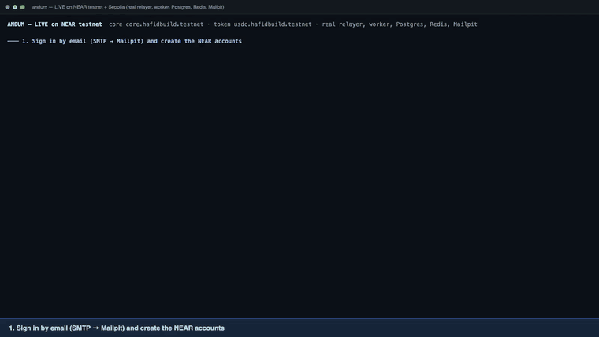

<details>
<summary>Run the terminal checks (commands)</summary>

```bash
node scripts/live/live-e2e.mjs               # full journey on NEAR testnet, 16 checks
node scripts/live/live-bridge.mjs            # bridge rehearsal (NET=sepolia for the real Sepolia)
```

To deploy your own copy: `./scripts/deploy-near.sh` (needs a funded testnet account key in `./secret`) and `./scripts/deploy-evm.sh sepolia`. Both are resumable. Full steps: [`docs/LIVE-RUNBOOK.md`](docs/LIVE-RUNBOOK.md).
</details>

## Trust points and mocks (be honest in the demo)

- All tokens are valueless mocks with an open faucet.
- The "bridge" is a trusted relayer that burns on one chain and mints on the other. The production path is NEAR Intents.
- The contract admin can upgrade the contract. It has no method that moves user funds.
- The backend holds invite secrets (encrypted) and releases one only after an emailed code. The secret becomes public in the accept transaction (single use, short deadline).
- Privy login is built but its NEAR signing is unverified; email login is the default path. Web3Auth is not implemented.
- The web app keeps each NEAR key in the browser's `localStorage`, unencrypted, and has no recovery screen yet: clearing site data loses the account (the API supports an encrypted key backup, the UI does not use it). A second device cannot sign in to the same email.
- Sign-in codes go to Mailpit on a local run. The deployed backend sends them through an SMTP provider (Brevo).
- The web app covers NEAR packages only, and withdrawals go to NEAR testnet addresses. Bridge, notification settings and the EVM side are API features without a screen yet.
- The browser tests need the live stack and testnet funds; the guard tests need only the API.
- The HTML prototypes and `andum-web/` are design material; all contract and backend code here is new.
