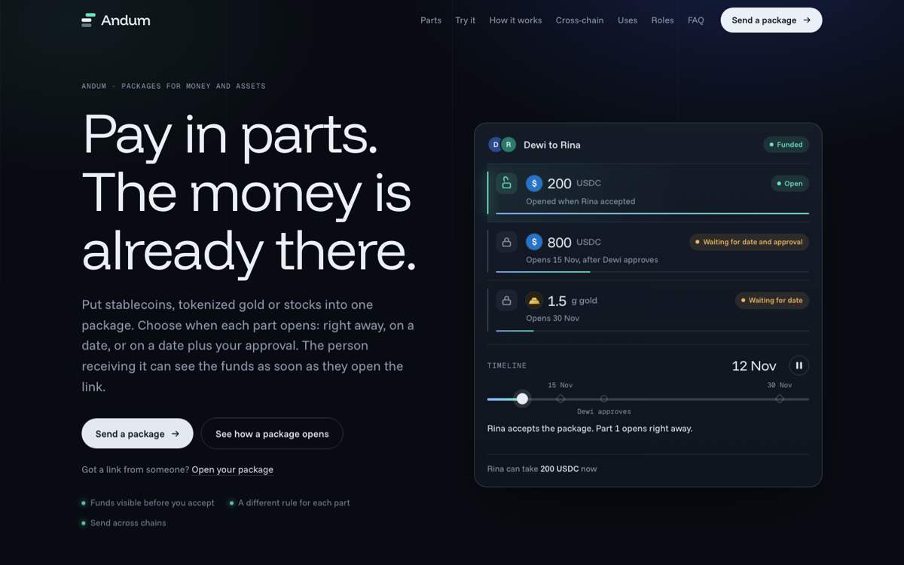
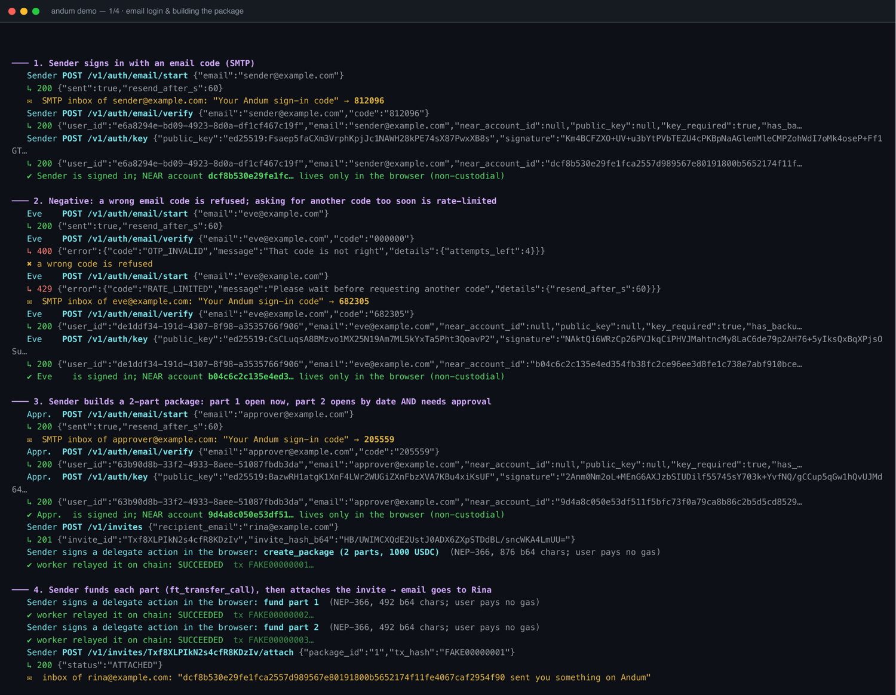
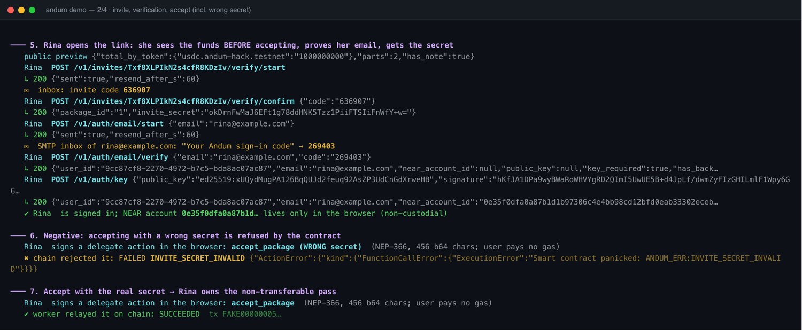
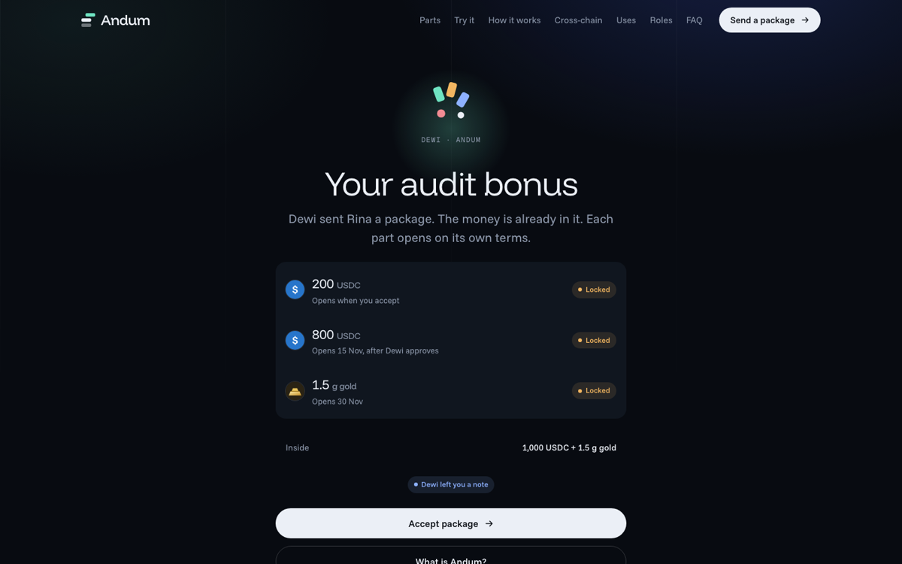
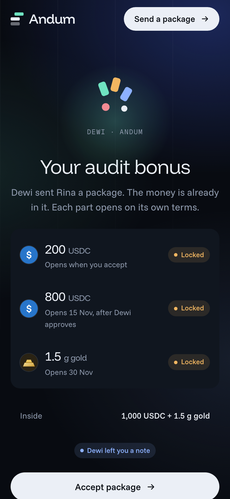
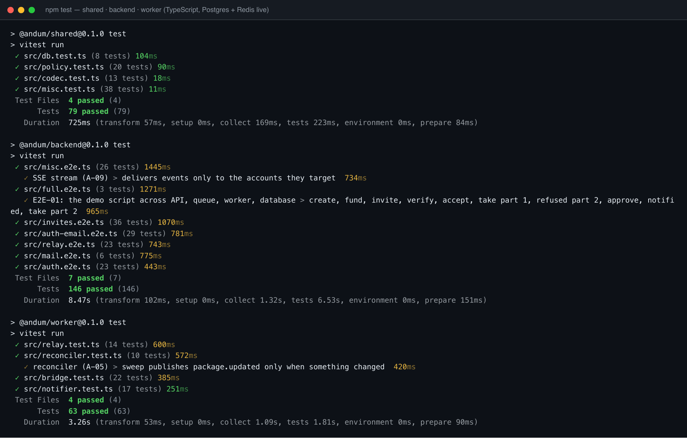

# Andum

**Send money and assets in one package.** Each part of a package opens on its own rule: right away, on a date, or on a date plus the approval of 1 to 5 people. The recipient holds the package as a non-transferable NFT pass, can see the funds before accepting, and nobody pays gas.



> **Status (12 Nov 2026):** the NEAR contracts and the EVM contracts are **deployed on testnet** and the full flow has run live against them through the real API, queue and worker. Everything is valueless test money. See [STATUS.md](STATUS.md) for what is done and what is not, and [ANDUM-PLAN.md](ANDUM-PLAN.md) for the design.

## Watch it work

Real API, relayer, worker, Postgres, Redis and email (Mailpit) against **NEAR testnet**, then the bridge against **Sepolia** (sped up; full video: [`docs/report/demo-live-testnet.mp4`](docs/report/demo-live-testnet.mp4)):


## How it works

1. **Sender** signs in with an email code, builds a package (up to 8 parts, each with its own rule), and funds it. All actions are signed in the browser and relayed, so the sender pays no gas.
2. **Recipient** opens a link, sees the funds before accepting, proves their email, and receives the invite secret. Accepting mints the pass.
3. **Each part** opens by its rule. A part with approvers waits until enough of them approve (for example 2 of 3). A claim is final and cannot be taken twice.
4. **Expired and unaccepted** packages can be reclaimed by the sender.

Sign-in is non-custodial: an email code proves the address, and the browser generates and keeps the NEAR key (encrypted backup is optional). The server never holds a user key.




### The recipient's page

| Desktop | Mobile |
|---|---|
|  |  |

The landing page and receiver view live in [`andum-web/`](andum-web/) (Vite + React). They are not wired to the API yet. A walkthrough: 

## Deployed contracts

### NEAR testnet (root account `hafidbuild.testnet`)

| Role | Account | What it does |
|---|---|---|
| core | [`core.hafidbuild.testnet`](https://testnet.nearblocks.io/address/core.hafidbuild.testnet) | Packages, parts, approvers, claim/reclaim, non-transferable NFT pass (NEP-171/177/181) |
| bridge | [`bridge.hafidbuild.testnet`](https://testnet.nearblocks.io/address/bridge.hafidbuild.testnet) | Demo bridge: burns outbound tokens, mints inbound on the relayer's word |
| relayer | [`relayer.hafidbuild.testnet`](https://testnet.nearblocks.io/address/relayer.hafidbuild.testnet) | Pays gas for users' delegate actions (NEP-366) and tops up new accounts |
| bridgeworker | [`bridgeworker.hafidbuild.testnet`](https://testnet.nearblocks.io/address/bridgeworker.hafidbuild.testnet) | Account the bridge worker signs `bridge_in` with |
| admin | [`admin.hafidbuild.testnet`](https://testnet.nearblocks.io/address/admin.hafidbuild.testnet) | Contract owner (pause, config). Holds no user funds |

Mock tokens (6 decimals, open capped faucet; USDC, IDRX and MYR are bridgeable):

| Token | Account |
|---|---|
| USDC | [`usdc.hafidbuild.testnet`](https://testnet.nearblocks.io/address/usdc.hafidbuild.testnet) |
| IDRX | [`idrx.hafidbuild.testnet`](https://testnet.nearblocks.io/address/idrx.hafidbuild.testnet) |
| MYR | [`myr.hafidbuild.testnet`](https://testnet.nearblocks.io/address/myr.hafidbuild.testnet) |
| XAU | [`xau.hafidbuild.testnet`](https://testnet.nearblocks.io/address/xau.hafidbuild.testnet) |
| AAPL | [`aapl.hafidbuild.testnet`](https://testnet.nearblocks.io/address/aapl.hafidbuild.testnet) |

Addresses are kept in [`deployments/near.testnet.json`](deployments/near.testnet.json). Contract methods and error codes are in `smart-contract-near/core/src` and `openspec/`.

### Sepolia

| Contract | Address |
|---|---|
| ERC-2771 forwarder | [`0x7FD46Af63cBC3B1f86123a2aa55e8b266279A19f`](https://sepolia.etherscan.io/address/0x7FD46Af63cBC3B1f86123a2aa55e8b266279A19f) |
| Gateway (demo bridge) | [`0x7168b9e971bBF030a386D6B7795f739Fb6d305FF`](https://sepolia.etherscan.io/address/0x7168b9e971bBF030a386D6B7795f739Fb6d305FF) |
| Relayer (bridge worker) | [`0x4469787CB7490704f86d462a626fe5B4252B884D`](https://sepolia.etherscan.io/address/0x4469787CB7490704f86d462a626fe5B4252B884D) |

| Token | Address |
|---|---|
| USDC | [`0xCbbDE212B6ea989be8010a4836c111aa0F6Dc169`](https://sepolia.etherscan.io/address/0xCbbDE212B6ea989be8010a4836c111aa0F6Dc169) |
| IDRX | [`0xd192192f558130Fec49afFDA1981f06D477f76Ac`](https://sepolia.etherscan.io/address/0xd192192f558130Fec49afFDA1981f06D477f76Ac) |
| MYR | [`0xB9C8eFfD6EF3877A936d4abf388c07A3C1cb8352`](https://sepolia.etherscan.io/address/0xB9C8eFfD6EF3877A936d4abf388c07A3C1cb8352) |
| SGD | [`0xD6189ceBC4dC2d55FfE8BcB0321014d98dFD5c28`](https://sepolia.etherscan.io/address/0xD6189ceBC4dC2d55FfE8BcB0321014d98dFD5c28) |
| THB | [`0xB214a70931a64E32dcac0D875b4a33D0e5DA14d7`](https://sepolia.etherscan.io/address/0xB214a70931a64E32dcac0D875b4a33D0e5DA14d7) |
| EUR | [`0xdf4e5454C43d4c8bD63c45aECb38713a4778546a`](https://sepolia.etherscan.io/address/0xdf4e5454C43d4c8bD63c45aECb38713a4778546a) |
| JPY | [`0x55BC63b90268514AC8c5e02c95410715b16e85Ff`](https://sepolia.etherscan.io/address/0x55BC63b90268514AC8c5e02c95410715b16e85Ff) |
| XAU | [`0xf64436776B4d9a182E69aD317a1698966d2753f4`](https://sepolia.etherscan.io/address/0xf64436776B4d9a182E69aD317a1698966d2753f4) |
| AAPL | [`0x7AC30647cC1cE87841964dF25058Ef0C2459Da55`](https://sepolia.etherscan.io/address/0x7AC30647cC1cE87841964dF25058Ef0C2459Da55) |
| NVDA | [`0x627d7f538a20eAdd707EBB30Cc458BBDf8Ab4347`](https://sepolia.etherscan.io/address/0x627d7f538a20eAdd707EBB30Cc458BBDf8Ab4347) |
| TSLA | [`0x431E5682565ac30cd0C98155f813B0b2589d7C19`](https://sepolia.etherscan.io/address/0x431E5682565ac30cd0C98155f813B0b2589d7C19) |

Addresses are kept in [`deployments/sepolia.json`](deployments/sepolia.json). Base Sepolia is not deployed yet.

## What is in the repo

| Folder | What |
|---|---|
| `smart-contract-near/` | Rust (near-sdk 5): `core`, `mock-ft` (faucet token), `bridge`, `integration` (sandbox tests on the real wasm) |
| `smart-contract-evm/` | Foundry: `MockERC20`, `AndumGateway` (burn/mint demo bridge, ERC-2771 gasless) |
| `backend/` | NestJS API: email login, sessions, invites + OTP, custom links, relay submit (policy checked), package reads, faucet, bridge quotes, SSE |
| `worker/` | NestJS worker: relayer (BullMQ), reconciler/indexer, notifier, bridge worker |
| `shared/` | NEP-366 codec, relayer policy engine, chain client, DB migrations, mailer |
| `andum-web/` | Landing page and receiver view (separate Vite app) |
| `scripts/` | `deploy-near.sh`, `deploy-evm.sh`, `keys.mjs`, `live/` (live checks), `demo/` (narrated demo), `report/` (video tools) |
| `openspec/` | Specs and tasks per change (`openspec list`, `openspec validate --all`) |
| `docs/` | [`LIVE-RUNBOOK.md`](docs/LIVE-RUNBOOK.md), [`interface-changes.md`](docs/interface-changes.md), [`report/`](docs/report/) (PDF report, videos, logs) |

## Tests

457 automated tests, all passing: 288 TypeScript (shared 79, backend 146, worker 63), 131 Rust (124 unit, 7 on the compiled wasm in the NEAR sandbox), 38 Solidity. They cover positive, negative and edge cases.



```bash
# NEAR contracts (Rust). First time: rustup default stable && rustup target add wasm32-unknown-unknown
cd smart-contract-near
cargo test --workspace --exclude andum-integration         # 124 unit tests
cargo build --release --target wasm32-unknown-unknown      # .cargo/config.toml adds --cfg near (required)
cargo test -p andum-integration -- --test-threads=1        # sandbox tests, downloads the NEAR sandbox once

# EVM
cd smart-contract-evm && forge test                         # 38 tests

# TypeScript (needs Postgres and Redis)
createdb andum_test    # defaults: postgres://andum@localhost:5544/andum_test and redis://localhost:6390
npm install && npm run build -w shared
npm test                                                    # shared + backend + worker
```

Override the test services with `TEST_DATABASE_URL` and `TEST_REDIS_URL`.

## Run it against the deployed testnet contracts

Full steps in [`docs/LIVE-RUNBOOK.md`](docs/LIVE-RUNBOOK.md). In short:

```bash
docker compose up -d mailpit                 # SMTP :1025, inbox UI http://localhost:8025
# start Postgres and Redis (docker compose up -d postgres redis, or local installs)
npm install && npm run build
set -a; . deployments/secrets/live.env; set +a   # relayer key etc. (gitignored; generate with: node scripts/keys.mjs gen)
node backend/dist/main.js &  node worker/dist/main.js &
node scripts/live/live-e2e.mjs               # full journey on NEAR testnet, 16 checks
node scripts/live/live-bridge.mjs            # bridge rehearsal (NET=sepolia for the real Sepolia)
```

To deploy your own copy: `./scripts/deploy-near.sh` (needs a funded testnet account key in `./secret`) and `./scripts/deploy-evm.sh sepolia`. Both are resumable.

## Trust points and mocks (be honest in the demo)

- All tokens are valueless mocks with an open faucet.
- The "bridge" is a trusted relayer that burns on one chain and mints on the other. The production path is NEAR Intents.
- The contract admin can upgrade the contract. It has no method that moves user funds.
- The backend holds invite secrets (encrypted) and releases one only after an emailed code. The secret becomes public in the accept transaction (single use, short deadline).
- Privy login is built but its NEAR signing is unverified; email login is the default path. Web3Auth is not implemented.
- The web app is a landing page plus receiver view, not yet a working product UI.
- The HTML prototypes and `andum-web/` are design material; all contract and backend code here is new.
